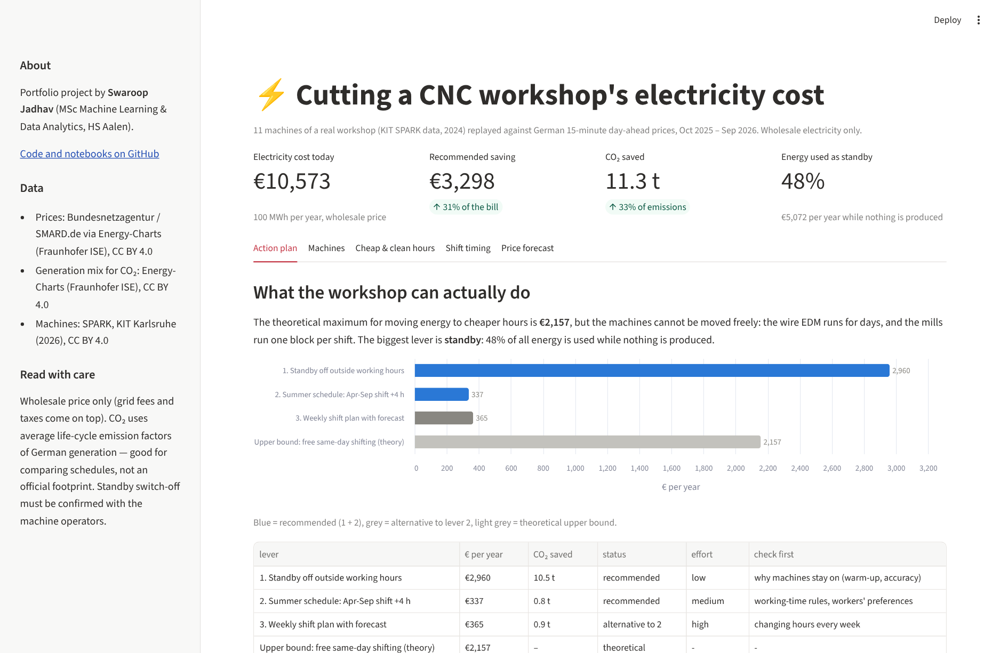
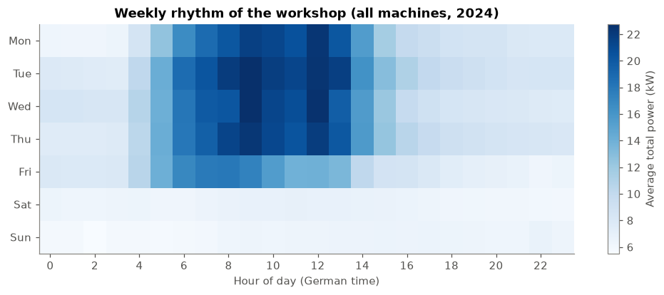
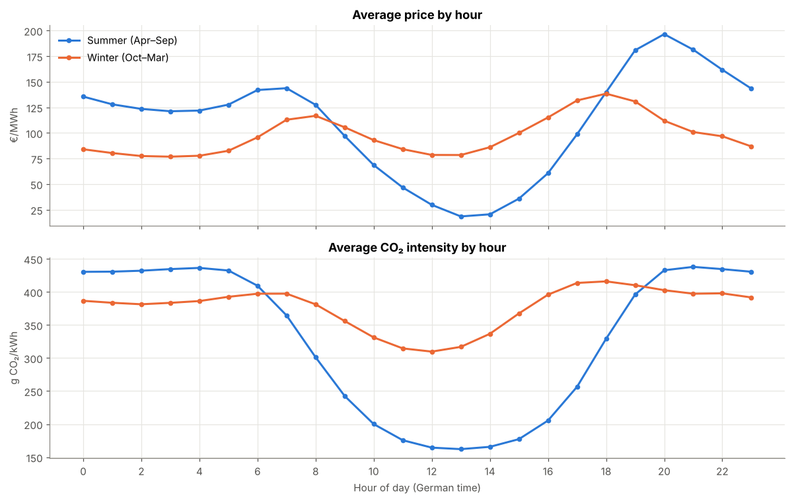

# Cutting a CNC Workshop's Electricity Cost with 15-Minute Prices

**🔗 Live dashboard: [industrial-load-shifting.streamlit.app](https://industrial-load-shifting.streamlit.app)**

Can a German workshop save money by running its machines at cheaper times? I replayed one year of real
5-second machine data from 11 CNC machines (KIT SPARK dataset) against German 15-minute day-ahead
electricity prices (Oct 2025 – Sep 2026), and tested what the workshop could realistically change.



## Key results

| | |
|---|---|
| Electricity cost today (wholesale) | **€10,573 / year** for 100 MWh |
| Energy used as **standby** (nights, weekends) | **48%** — €5,072 / year while nothing is produced |
| Theoretical maximum from load shifting | €2,157 / year |
| **Realistic** saving from load shifting | €337 / year — only **16%** of the theoretical maximum |
| **Recommended action plan** | **€3,298 / year (31% of the bill)** and **11.3 t CO₂ (33%)** |

1. **The biggest problem is not *when* machines run, but that some never switch off.** One milling machine
   (DNG 50 evo) draws 4.1 kW day and night; its standby alone costs more than all possible load shifting.
2. **Load shifting is limited by how machines really run.** The wire EDM runs for days without stopping and the
   mills run one block per shift, so only the whole shift can move. A later shift pays off only from April to
   September, when solar makes midday cheap.
3. **Cheap hours are clean hours.** Price and grid CO₂ intensity correlate at 0.70 (0.76 in summer), so saving
   money and saving CO₂ point in the same direction.
4. **A simple forecast beat machine learning.** For planning 2–7 days ahead, a 7-day average (MAE 37.9 €/MWh)
   was as accurate as LightGBM (38.8) and captured 96–98% of the perfect-knowledge saving vs. 92–93%.

**Recommendation for the plant manager:** (1) switch standby off outside working hours, after confirming with the
operators that the machines don't need to stay warm (€2,960 / year); (2) introduce a summer schedule that starts the
shift 4 hours later from April to September (€337 / year).

## Approach

| # | Notebook | Question | Main finding |
|---|---|---|---|
| 01 | [Data exploration](notebooks/01_data_exploration.ipynb) | What do prices and machine loads look like? | Daily price spread (164 €/MWh) is larger than the average price |
| 02 | [Cost baseline](notebooks/02_cost_baseline.ipynb) | What does today's schedule cost, and what is the most shifting could save? | 48% of energy is standby; upper bound €2,157 |
| 03 | [Price forecast](notebooks/03_price_forecast.ipynb) | Can we plan with prices that are not published yet? | Simple 7-day average beats LightGBM for this decision |
| 04 | [Action plan](notebooks/04_optimisation.ipynb) | What can the workshop *actually* do? | Standby off + summer schedule: €3,298 / year |
| 05 | [CO₂ & results](notebooks/05_co2_and_results.ipynb) | Is the plan also good for the climate? | 11.3 t CO₂ saved; cheap hours are clean hours |

Every assumption and decision (with alternatives and reasons) is documented in the
[assumptions & decision log](docs/assumptions_log.md).

<p float="left">
  
  
</p>

## Methods worth mentioning

- **Data pipeline:** REST API downloads (rate-limited, validated), 5-second → 15-minute resampling of ~70 million
  readings, clock-change handling, gap filling for logger outages (4.9% of the year).
- **Validation before modelling:** extreme prices (−500 / +747 €/MWh) checked against the calendar and kept as real
  market events; small negative power readings treated as sensor noise.
- **Upper bound before optimisation:** estimate the theoretical maximum first, so a small business case can be
  stopped early — then compare it with what is realistically possible.
- **Leakage-free forecasting:** features restricted to information available on the planning day, rolling-origin
  backtest with a 7-day gap, and evaluation by **business value** (saving captured), not only by error.
- **Simple where simple is enough:** the shift decision has 5 options per week, so full enumeration replaced
  linear programming.
- **One source of truth:** a results module feeds the notebooks, the Streamlit dashboard and Power BI.

## Limitations

- Wholesale price only — grid fees, taxes and levies come on top and would raise the absolute € values.
- Machine data from 2024 is replayed against 2025/26 prices (same week of the year, weekday and time of day).
- Standby switch-off and later shifts must be confirmed with operators and workers before acting.
- CO₂ uses average (not marginal) emission factors — suitable for comparing schedules, not an official footprint.
- Price forecasts use no weather data; weather forecasts would be the most valuable improvement.

## Project structure

```
├── dashboard/          # Streamlit app + small result tables (dashboard/data)
├── data/               # raw downloads and processed files (not in Git, re-created by the scripts)
├── docs/               # assumptions & decision log
├── notebooks/          # analysis notebooks 01–05
├── reports/figures/    # exported charts
└── src/                # data pipeline, cost model, forecasting, optimisation, CO₂, results
```

## How to run

```bash
python -m venv .venv
.venv\Scripts\activate                # Mac/Linux: source .venv/bin/activate
pip install -r requirements.txt

python src/download_prices.py         # 15-minute day-ahead prices (~6 min, API rate limit)
python src/extract_spark_power.py     # after downloading the 11 TEC_*.zip files from the SPARK dataset
python src/load_spark_data.py
python src/download_generation.py     # generation mix for CO₂ (~6 min)
jupyter lab                           # run notebooks 01–05 in order (05 writes dashboard/data)
streamlit run dashboard/app.py
```

**Tools:** Python, pandas, NumPy, LightGBM, matplotlib, Altair, Streamlit, Power BI, Git

---
**Author:** Swaroop Jadhav · MSc Machine Learning & Data Analytics, Hochschule Aalen

*Data: day-ahead prices — Bundesnetzagentur | SMARD.de via Energy-Charts (Fraunhofer ISE), CC BY 4.0;
generation mix — Energy-Charts (Fraunhofer ISE), CC BY 4.0; machine data — SPARK, Sievers, Bischof, Simon, Blank,
KIT (2026), CC BY 4.0, and HIPE, Bischof et al., KIT, CC BY 4.0.*
